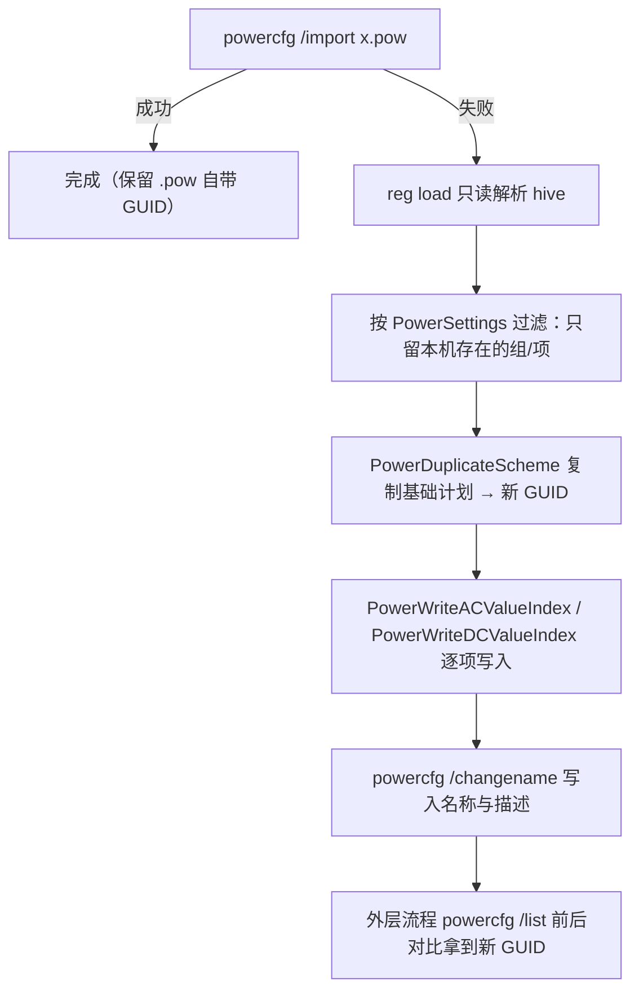

# 电源计划导入修复：GGOS / PowerX 在 Win11 26H2 导不进来

日期：2026-11-21
范围：`src-tauri/src/optimization.rs` 里 `.pow` 导入链路（`import_power_plan` → `import_plan_file`）
状态：已实现，`cargo check` 通过；真机复测需重新构建应用后点一次导入

## 1. 现象

应用里点「导入」GGOS Desktop Gaming / PowerX v2，弹窗：

> 导入电源计划失败: 找不到该文件。
> （已自动移除本机不支持的电源设置项后重试，仍失败: 指定的值存在格式错误，或者不在目标电源设置的范围内。）

同一台机器上，ACMEPCAMD 能正常导入（AMD / Intel / 卓越性能 早就装好，没有单独复测）。

修复后这条提示的第二段文案改为「（已尝试按本机支持的设置重建电源计划，仍失败: …）」，与新的兜底行为对应。

## 2. 复现

本机 Windows 11 26H2，`10.0.26300.10075`。直接跑命令即可复现：

```bat
powercfg /import "D:\NexBox\power-plans\ggOS Desktop Gaming.pow"   :: 找不到该文件。(rc=1)
powercfg /import "D:\NexBox\power-plans\PowerX-v2.pow"             :: 找不到该文件。(rc=1)
powercfg /import "D:\NexBox\power-plans\ACMEPCAMD.pow"             :: 已成功导入电源方案。GUID: 6d6fafcf-...
```

- 两个失败文件都是合法 hive（文件头 `regf`，大小 20KB / 28KB），不是路径、空格、权限或文件损坏问题。
- 把普通文本文件改名成 `.pow` 再导，报的是 `0x3f8` 注册表 I/O 错误——说明错误码是分层级的，`找不到该文件` 不是"磁盘上没这个文件"，而是注册表取值失败（`ERROR_FILE_NOT_FOUND`）被 `powercfg` 原样抛出。

## 3. 根因

### 3.1 Windows 26H2 起 `/import` 变成逐项严格校验

同一份 `.pow` 在 25H2 上能导入，26H2 报「指定的值存在格式错误，或者不在目标电源设置的范围内」，这是系统行为变化，不是文件损坏（社区同款报告：<https://learn.microsoft.com/zh-cn/answers/questions/6032325/win11-26h2-26300-9550>）。校验是**整份事务**：任何一项被拒，整份计划都不落盘。

### 3.2 这两份 `.pow` 里到底有什么不合规

对照本机 `HKLM\SYSTEM\CurrentControlSet\Control\Power\PowerSettings`（系统支持的全部组/设置项）：

| 文件 | 本机不存在的组 | 本机不存在的设置项 | 类型异常的项 | 空设置键 |
| --- | --- | --- | --- | --- |
| ggOS Desktop Gaming | — | `0012ee47-…/6b013a00-…` | 2 处 `AC/DCSettingIndex` 存成 4 字节 `REG_BINARY` | `9596fb26-…/03680956-…` |
| PowerX v2 | `44f3beca-a7c0-460e-9df2-bb8b99e0cba6` | `54533251-…/68dd2f27-…`、`54533251-…/df142941-…` | 3 处 `REG_BINARY` | — |
| ACMEPCAMD（能导入） | — | — | — | — |

对应到两条错误（第一条是推断，没法单独做 A/B；但下面的重建方案不依赖这个判断）：

- **不存在的组/设置项 → `找不到该文件`**：导入器在注册表里查这个 GUID，查不到时返回的正是 `ERROR_FILE_NOT_FOUND`。
- **类型不对 / 越界 → `指定的值存在格式错误，或者不在目标电源设置的范围内`**：26H2 新增的逐项校验。

### 3.3 旧的兜底路径为什么也救不回来

旧实现在直接导入失败后做 hive 手术：`reg load` 挂载 `.pow` → 复制到 `HKCU\Software\NexBox\PowerPlanTemp\{guid}`（删掉本机不存在的组/项，把 4 字节 `REG_BINARY` 改成 `REG_DWORD`）→ `reg save` 成新 `.pow` → 再 `powercfg /import` 一次。

问题在于：

1. 重建出的 hive 仍带着边角（空设置键、组级 `ACSettingIndex`），26H2 依然一票否决；用户看到的第二条错误就是这么来的。
2. 这条路径必须管理员（`reg load` / `reg save` 需要 SE_BACKUP），每次导入要起 4 个进程，还多写一份临时文件。
3. 复制 hive 只是"看起来像"，值类型、范围、空键这些语义规则全靠猜，系统升级一次就得再猜一次。

## 4. 新方案：不碰 hive，用系统 API 重建计划



设计取舍：

1. **只在直接导入失败时介入。** 25H2 或系统能接受的计划仍走原生 `/import`，保留 `.pow` 内嵌 GUID 与全部原始数据。
2. **解析与写入分离。** `reg load` 只用来读：拿到根键上的 `FriendlyName` / `Description` 和每个设置项的 AC/DC 值；不再生成任何 hive 文件。
3. **不支持就跳过，而不是整体失败。** 过滤规则复用 `get_supported_power_settings()`（本机 `PowerSettings` 的组 → 设置项集合），未知组/项直接略过。
4. **类型问题在读的时候归一化。** `ACSettingIndex` / `DCSettingIndex` 允许 `REG_DWORD`，也接受被写坏的 4 字节 `REG_BINARY`；其余类型当作没有该值。
5. **写入交给 `powrprof.dll`。** `PowerWriteACValueIndex` / `PowerWriteDCValueIndex` 就是 `powercfg /setacvalueindex` 底层用的同一套接口，校验规则与系统完全一致，单条被拒不影响其它项。
6. **基础模板按"最接近第三方计划"排序。** 「卓越性能」→「Ultimate Performance」→「高性能」→「High performance」→ 当前激活计划 → 计划列表第一条。第三方游戏计划基本都从这些模板派生，继承值最接近原意。
7. **间接字符串还原。** 系统内置计划把名称存成 `@%SystemRoot%\system32\powrprof.dll,-19,Ultimate Performance`，写入前取最后一个逗号后的显示名。
8. **失败不留垃圾。** 重命名失败时顺手 `powercfg /delete` 掉刚复制出来的计划，避免设置页多出一个重名条目。

## 5. 代码位置

| 位置 | 作用 |
| --- | --- |
| [`optimization.rs:3221`](../src-tauri/src/optimization.rs) `import_plan_file` | 先直接导入，失败后转重建 |
| [`optimization.rs:3171`](../src-tauri/src/optimization.rs) `rebuild_power_plan_from_file` | 重建主流程：复制 → 写值 → 改名 |
| [`optimization.rs:3080`](../src-tauri/src/optimization.rs) `read_power_plan_source` | `reg load` 只读解析 + 过滤 + 取名称/描述 |
| [`optimization.rs:3151`](../src-tauri/src/optimization.rs) `duplicate_power_scheme` | 调 `PowerDuplicateScheme`，`LocalFree` 释放返回指针 |
| [`optimization.rs:3163`](../src-tauri/src/optimization.rs) `pick_base_power_scheme` | 选基础模板 |
| [`optimization.rs:3071`](../src-tauri/src/optimization.rs) `read_power_index` | `REG_DWORD` / 4 字节 `REG_BINARY` → `u32` |
| [`optimization.rs:3062`](../src-tauri/src/optimization.rs) `plain_power_plan_text` | 间接字符串 → 显示名 |
| [`optimization.rs:3000`](../src-tauri/src/optimization.rs) `get_supported_power_settings` | 本机支持的组/项（沿用） |

删掉的：`sanitize_power_plan_file`（整段 hive 手术 + `reg save`），连同里面那处 `format!("HKCU\\{}\{}")` 的转义 bug 一起消失。

顶层依赖新增：`windows_sys::Win32::System::Power::{PowerDuplicateScheme, PowerWriteACValueIndex, PowerWriteDCValueIndex}`、`windows_sys::Win32::Foundation::LocalFree`（`windows-sys 0.59` 已有 `Win32_System_Power` feature，无需改 `Cargo.toml`）。

## 6. 验证

### 6.1 复现与对照（本机真机）

见第 2 节：GGOS / PowerX 直接导入失败，ACMEPCAMD 成功——与应用里的现象一致。

### 6.2 提取 + 重建规则的离线复刻

用 Python + `regipy` 复刻「读 hive → 按 `PowerSettings` 过滤 → 复制模板 → 逐项写值 → 改名」的完整流程，在同一台机器上跑两份真实文件：

| 计划 | 提取项 | 系统拒绝 | 结果 |
| --- | --- | --- | --- |
| ggOS Desktop Gaming | 59 | 0 | 名称/描述正确，`PROCTHROTTLEMIN` 查回 `0x64`（与 `.pow` 一致） |
| PowerX v2 | 89 | 0 | 名称/描述正确 |

说明：所有值本身系统都接受，26H2 拒绝的是 hive 整体，不是这些调校值。测试计划验证完已全部 `powercfg /delete`。

### 6.3 Rust 侧调用探针

单独编译一个小程序，直接调用与实现里完全相同的 `PowerDuplicateScheme` / `PowerWriteACValueIndex` / `PowerWriteDCValueIndex`：

- GUID 解析与回写往返一致（`uuid::Uuid::as_fields` ↔ `from_fields`）；
- 写入 AC=42 / DC=43 后 `powercfg /query` 读回 `0x2a` / `0x2b`，字节序无误；
- `powercfg /changename`、`/delete` 均返回 0。

### 6.4 编译

`cargo check`（lib + bin）通过。

## 7. 已知限制

- **需要管理员**：解析阶段仍用 `reg load`，非管理员会返回「载入电源计划文件失败」。这与旧实现一致，应用本身以管理员运行不受影响。
- **个别值会被静默跳过**：系统拒绝某条 `AC/DCSettingIndex` 时只跳过该条，不阻断整份计划；如果将来需要可见反馈，可以在重建时累计失败条数写进返回信息。
- **重建后 GUID 是新的**：与 `.pow` 内嵌 GUID 不同。这是既有行为——`import_power_plan` 本来就靠导入前后 `/list` 的差异定位新计划。
- **基础模板决定"未提及项"的取值**：`.pow` 里没有的设置项继承模板值（所以优先选卓越性能/高性能）。如果某份计划刻意依赖"未设置即默认"，需要改成复制后逐项清零，目前没这么做。

## 8. 复测步骤

1. `powercfg /list` 确认没有同名的 GGOS / PowerX；有就先 `powercfg /delete <guid>`（本机目前已有 `7bc2ec07…` 的 ggOS Desktop Gaming 和 `d036290d…` 的 PowerX v2）。
2. 重新构建应用（`pnpm tauri build` 或 `cargo build --release`）后点一次「导入」。
3. 预期：设置页显示已导入，`powercfg /list` 多出一条，名称/描述与 `.pow` 一致；日志里不再出现「找不到该文件」。

## 9. 附：本次排查用到的关键命令

```bat
:: 复现
powercfg /import "D:\NexBox\power-plans\ggOS Desktop Gaming.pow"

:: 看系统支持哪些组/设置项（判断 .pow 里哪些项该丢）
reg query "HKLM\SYSTEM\CurrentControlSet\Control\Power\PowerSettings" /s

:: 手工验证 API 路径（复制 → 写值 → 改名 → 查回 → 删除）
powercfg /duplicatescheme e8ecb8ec-e7a3-4b8f-8652-58cf56f08829
powercfg /setacvalueindex <新GUID> 54533251-82be-4824-96c1-47b60b740d00 893dee8e-2bef-41e0-89c6-b55d0929964c 100
powercfg /changename <新GUID> "计划名" "描述"
powercfg /query <新GUID> 54533251-82be-4824-96c1-47b60b740d00 893dee8e-2bef-41e0-89c6-b55d0929964c
powercfg /delete <新GUID>
```
